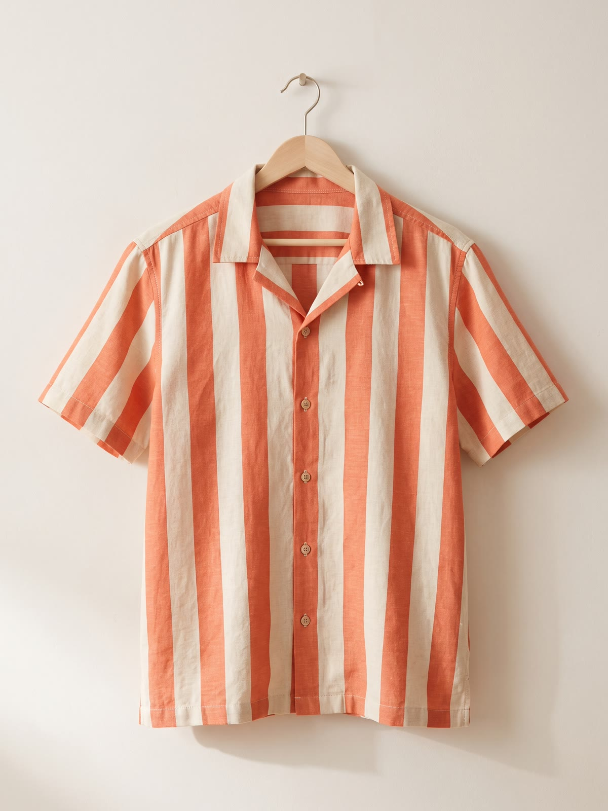
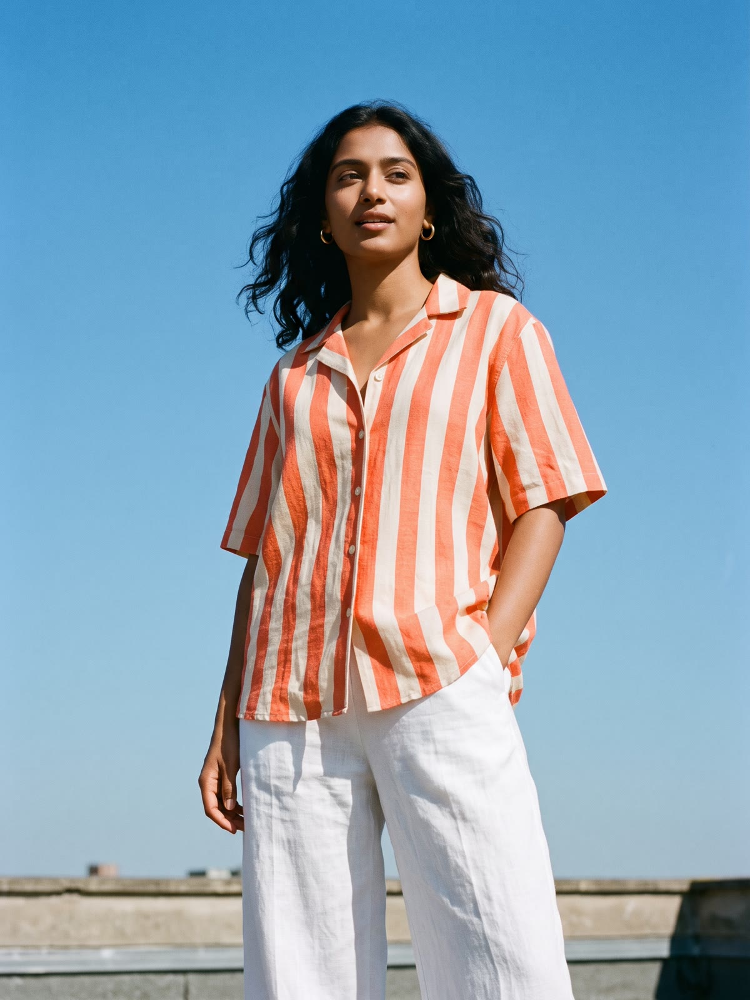

<div align="center">

# Rayé · Striped Shirts

<p align="center">
  <em><strong>"12 shirts, all striped. Coastal retro-editorial meets soft neo-brutalism."</strong></em><br>
  Woven and sewn with love in Narayanganj, Bangladesh.
</p>

[](https://nextjs.org/)
[](https://react.dev/)
[](https://tailwindcss.com/)
[](#-live-interactive-pages-zero-dependencies)
[](./docs/02_DESIGN_SYSTEM.md)
[](LICENSE)

<br />


<br /><br />

[Explore Catalog](./shop.html) • [Our Story](./about.html) • [Find Your Size](./product.html) • [Admin Back Office](./admin.html) • [Architecture Specs](./docs/01_PROJECT_OVERVIEW.md)

</div>

---

## 🌟 Executive Summary

**Rayé** (*French for "striped"*, pronounced `/ʁɛ.je/`) is an e-commerce flagship concept store focused on a single iconic silhouette: **the unisex relaxed camp-collar striped shirt**. 

Engineered from 100% yarn-dyed 55% French linen and 45% combed cotton at 140 GSM, Rayé balances breathable tropical comfort with crisp coastal drape. The storefront combines a warm **coastal editorial aesthetic** with **kinetic soft neo-brutalism** — tactile offset box shadows, fluid spring-physics transitions, kinetic photo hover swaps, and an anthropometric size recommendation engine.

---

## 🎨 Visual Identity & Design System

The visual language pairs high-contrast neo-brutalist structure (offset drop shadows, crisp `1.5px` ink borders) with warm, organic Mediterranean & Bengal coastal tones.

### Color Palette

| Swatch | Color Name | Hex Code | Token | Usage |
| :---: | :--- | :--- | :--- | :--- |
|  | **Tomato Coral** | `#EF5E4B` / `#FF5C3D` | `--color-tomato` | Hero callouts, active tags, primary actions, heart badges |
|  | **Pine Slate** | `#0E4F4B` / `#14675F` | `--color-pine` | Navigation accents, primary buttons, pill backgrounds |
|  | **Butter Khaki** | `#FFD66B` / `#FFE7A3` | `--color-butter` | Badges, marquee borders, sticky sunburst seal, highlight pills |
|  | **Floral Cream** | `#FBF6EE` / `#F4ECDF` | `--color-cream` | Canvas background, card surface, drawer base |
|  | **Jet Charcoal** | `#17130F` / `#2A2724` | `--color-jet` | Sharp structural borders, offset drop shadows, deep typography |
|  | **Lido Sky** | `#9FC3E0` | `--color-light-steel-blue` | Harbour & maritime stripe variations |

### Typography Pairing

- **Display Serif:** `Instrument Serif` (Italic 400) — Editorial elegance, storytelling titles, section headers.
- **Structural Heading:** `Archivo` (Black 800) — Bold, high-impact numbers, kicker labels, and badges.
- **Interface Sans:** `Instrument Sans` (Medium 500 / SemiBold 600) — Legible UI labels, prices, sizing pills, metadata.
- **Numeric Mono:** `ui-monospace` (Bold 700) — Financial ledger figures, SKU indicators, order codes.

### Tactile Neo-Brutalist Shadows

```css
:root {
  --border-ink: 1.5px solid #17130F;
  --shadow-flat: 2px 2px 0px #17130F;
  --shadow-card: 4px 4px 0px #17130F;
  --shadow-hover: 6px 6px 0px #17130F;
  --shadow-modal: 8px 8px 0px #17130F;
}
```

---

## 📸 Product Photography & Visual Interactions

Each shirt card features an instant, kinetic **flat-lay to on-model lifestyle crossfade** on hover:

<div align="center">
  <table>
    <tr>
      <th align="center" width="50%"><strong>Flat Hanger Lay (Default State)</strong></th>
      <th align="center" width="50%"><strong>On-Model Lifestyle (Hover State)</strong></th>
    </tr>
    <tr>
      <td align="center">
        
        <br /><em>Sunday Stripe · Wooden Hanger View</em>
      </td>
      <td align="center">
        
        <br /><em>Sunday Stripe · Outdoor Salt-Air Fit</em>
      </td>
    </tr>
  </table>
</div>

---

## 🌐 Live Interactive Pages (Zero Dependencies)

Every single page is delivered as a production-grade, standalone HTML5 document requiring **zero npm installs or build steps**. Simply open any file in your browser:

| Page | File | Interactive Capabilities |
| :--- | :--- | :--- |
| **🏠 Storefront Home** | [`index.html`](./index.html) | Rotating scallop sunburst seal, infinite marquee ticker, *The Edit / 02* catalog preview with **tactile ghost skeleton shimmer loading**, *The Feel / 05* fabric specs, customer polaroids, and limited-drop countdown timer. |
| **🛍️ Catalog & Shop** | [`shop.html`](./shop.html) | Multi-facet filtering by sleeve (`short`/`long`/`oversized`), 6 color families, 6 sizes, and stock availability with **fluid ghost skeleton shimmer loading**, and instant sort order (`Featured`, `Price Low/High`). |
| **👕 Product Detail (PDP)** | [`product.html`](./product.html) | Dual gallery stage (Flat vs Model toggle), dynamic swatch selector, instant size pill picker, accordion specs, and the **Anthropometric Mannequin Size Calculator**. |
| **👜 Shopping Bag** | [`cart.html`](./cart.html) | Dynamic ৳3,000 free-shipping progress tracker, animated quantity stepper `[-] [1] [+]`, promo discount engine (`RAYE10`, `SALTAIR`), and instant checkout redirect. |
| **❤️ Wishlist & Saved** | [`wishlist.html`](./wishlist.html) | Grid of saved shirts with persistent `localStorage` synchronization, one-click heart remove animation, and inline quick-add drawer. |
| **📖 Brand Story** | [`about.html`](./about.html) | Narayanganj handloom history, the 4-step craft process (Spin, Dye, Weave, Tailor), ethical artisan standards, and workshop photography. |
| **📰 Editorial Journal** | [`journal.html`](./journal.html) | 3 editorial essays (*"How to wear stripes in 35°C"*, *"Inside the weave"*, *"One shirt, five ways"*) with modal article reader. |
| **💬 Help & FAQs** | [`help.html`](./help.html) | 4 tabbed panels: collapsible accordions, 14-day Dhaka return courier schedule, size comparison chart, and direct WhatsApp contact modal. |
| **💳 Seamless Checkout** | [`checkout.html`](./checkout.html) | 20 Bangladesh district selectors, shipping method switcher (Standard, Outside Dhaka, Express), and COD / bKash / Card payment tabs. |
| **📦 Order Tracking** | [`order.html`](./order.html) | Animated success checkmark, 4-stage live courier timeline (*Placed* → *Packed* → *On the Way* → *Delivered*), and receipt download. |
| **👤 Customer Account** | [`account.html`](./account.html) | Customer profile management, past order timeline, live status badges, and saved addresses. |
| **⚡ Admin Back Office** | [`admin.html`](./admin.html) / [`admin/`](./admin/index.html) | **Drag & Drop Kanban Fulfillment Board**, sales spline chart, size-level inventory steppers, CRM ledger, and fit analytics. |

---

## 📐 Signature Features

### 1. Anthropometric Size Recommendation Engine
Built directly into [`product.html`](./product.html) and [`docs/05_INTERACTIVE_SIZE_CALCULATOR.md`](./docs/05_INTERACTIVE_SIZE_CALCULATOR.md):
- Dual interactive range sliders for Height ($150\text{ cm} - 195\text{ cm}$) and Weight ($45\text{ kg} - 110\text{ kg}$).
- Real-time chest circumference estimation:
  $$\text{Chest} = 0.3 \cdot \text{Height} + 0.55 \cdot \text{Weight} + 5\text{ cm}$$
- Dynamic mannequin visual preview showing intended garment ease ($+12\text{ cm}$ relaxed camp-collar fit).
- One-click size lock into cart.

### 2. Back Office Operations & Admin Panel
Built into [`admin.html`](./admin.html) & [`admin/index.html`](./admin/index.html):
- **Interactive Kanban Board:** Drag & drop orders across 5 columns: *New* → *Packing* → *Shipped* → *Delivered* → *Restock*.
- **Real-Time Revenue Analytics:** Weekly spline chart tracking revenue vs. target benchmarks.
- **Inventory Matrix Controller:** Instant size-level stock steppers (XS through XXL) with low-stock warnings.
- **Customer CRM:** Customer purchase frequency, lifetime value (LTV), and return rates.

---

## 📁 Repository Structure

```
raye-store-spec/
├── .gitignore                 # Standardized Git ignore rules
├── README.md                  # Master documentation & visual guide
│
├── admin/                     # Admin Back Office Suite
│   ├── index.html             # Admin route entry (/admin/)
│   ├── admin_bundle.js        # Bundled React IIFE application
│   └── raw/                   # Raw build source modules & styles
│
├── docs/                      # Comprehensive 8-Part Specification Suite
│   ├── 01_PROJECT_OVERVIEW.md
│   ├── 02_DESIGN_SYSTEM.md
│   ├── 03_PAGE_SPECIFICATIONS.md
│   ├── 04_ANIMATIONS_AND_INTERACTIONS.md
│   ├── 05_INTERACTIVE_SIZE_CALCULATOR.md
│   ├── 06_DATA_MODELS_AND_CATALOG.md
│   ├── 07_STEP_BY_STEP_IMPLEMENTATION.md
│   ├── 08_ADMIN_PANEL_SPECIFICATIONS.md
│   └── reference/             # Benchmark design assets & scripts
│
├── images/                    # 34 High-resolution campaign & garment photos
│   ├── hero.jpg               # Campaign banner
│   ├── feel.jpg               # Linen texture close-up
│   ├── shirt-sunday.jpg       # Flat-lay garment shots
│   ├── shirt-sunday-model.jpg # On-model lifestyle photography
│   └── ...                    # All 12 colorway variations
│
├── src/                       # Next.js 15 / React TypeScript Architecture
│   ├── app/                   # App Router pages (/shop, /product/[slug])
│   ├── components/            # UI Components (Hero, Navbar, SizingModal)
│   ├── data/                  # Typed product catalogs & reviews
│   └── store/                 # Zustand state management (cart & wishlist)
│
├── index.html                 # Complete standalone Homepage
├── shop.html                  # Complete standalone Shop Catalog
├── product.html               # Complete standalone PDP & Sizing
├── cart.html                  # Complete standalone Shopping Bag
├── checkout.html              # Complete standalone Checkout Flow
├── order.html                 # Complete standalone Order Tracking
├── wishlist.html              # Complete standalone Saved Items
├── account.html               # Complete standalone User Account
├── about.html                 # Complete standalone Brand Story
├── journal.html               # Complete standalone Editorial Journal
├── help.html                  # Complete standalone Help Center
└── admin.html                 # Root Admin Panel redirect
```

---

## 🚀 Quick Start Guide

### Option A: Instant Browser Preview (Zero Install)
Double-click any HTML file (e.g. [`index.html`](./index.html)) or open it directly in Google Chrome, Edge, Safari, or Firefox:
```bash
# macOS / Linux
open index.html

# Windows PowerShell
Start-Process index.html
```
All cart items, wishlist saves, and orders automatically persist across tabs using browser `localStorage`.

### Option B: Next.js 15 Implementation
To build or deploy the full React/TypeScript web app:
```bash
# 1. Install dependencies
npm install

# 2. Run the development server
npm run dev

# 3. Open in your browser
# http://localhost:3000
```

---

## 📜 Complete Specification Suite

For developers implementing the store in Next.js, Remix, Shopify Hydrogen, or Astro, refer to the step-by-step specifications:

1. **[01. Project Overview & Architecture](./docs/01_PROJECT_OVERVIEW.md)** — Brand mission, target audience, stack breakdown.
2. **[02. Design System & Tokens](./docs/02_DESIGN_SYSTEM.md)** — Typography, sampled hex tokens, neo-brutalist shadows, seals.
3. **[03. Page-by-Page Layout Specs](./docs/03_PAGE_SPECIFICATIONS.md)** — Pixel dimensions, container widths, responsive grids.
4. **[04. Animations & Micro-Interactions](./docs/04_ANIMATIONS_AND_INTERACTIONS.md)** — Spring physics, cubic-beziers, hover crossfades.
5. **[05. Interactive Size Calculator](./docs/05_INTERACTIVE_SIZE_CALCULATOR.md)** — Anthropometric formulas, mannequin SVG, ease rules.
6. **[06. Data Models & Catalog Schema](./docs/06_DATA_MODELS_AND_CATALOG.md)** — Complete 12-shirt dataset, JSON schema, reviews.
7. **[07. Engineering Implementation Guide](./docs/07_STEP_BY_STEP_IMPLEMENTATION.md)** — Next.js 15 boilerplates, Tailwind v4 config, QA checks.
8. **[08. Admin Panel Specifications](./docs/08_ADMIN_PANEL_SPECIFICATIONS.md)** — Kanban boards, sales charts, inventory steppers, CRM.

---

<div align="center">

**Rayé Striped Shirts** · Woven with pride in Narayanganj, Bangladesh.  
Crafted with soft neo-brutalist care for modern web standards.

</div>
