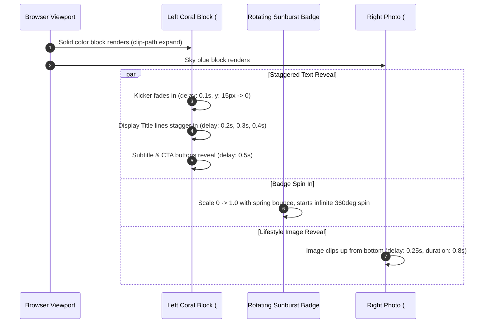

# Rayé Animations & Micro-Interactions Guide

This specification defines all animations, transition curves, scroll-triggered choreographies, and state interactions that give **Rayé** its distinctive dynamic feel.

---

## 1. Animation Principles & Timing Functions

The animation philosophy balances **retro editorial warmth** with **modern, tactile snappiness**:
- **Easing Curve:** Custom cubic-bezier spring `cubic-bezier(0.16, 1, 0.3, 1)` (snappy ease-out, no sluggish damping).
- **Duration Scale:**
  - Micro-interactions (hover, button click): `150ms – 250ms`.
  - UI state changes (toast slide, quick-add bar): `300ms – 400ms`.
  - Page entrance & card fan-out: `600ms – 800ms`.
  - Ambient continuous motions (sunburst rotate, ticker): `20s – 25s`.

---

## 2. Hero Split Entrance Animation (0.00s – 1.50s)

When the homepage loads, the hero splits into two distinct visual blocks with staggered entrance animations:



### Framer Motion Implementation Spec

```tsx
// Hero Split Variants
export const heroTextVariants = {
  hidden: { opacity: 0, y: 24 },
  visible: (custom: number) => ({
    opacity: 1,
    y: 0,
    transition: {
      delay: custom * 0.12,
      duration: 0.65,
      ease: [0.16, 1, 0.3, 1],
    },
  }),
};

export const heroImageVariants = {
  hidden: { opacity: 0, scale: 1.06, clipPath: "inset(100% 0% 0% 0%)" },
  visible: {
    opacity: 1,
    scale: 1,
    clipPath: "inset(0% 0% 0% 0%)",
    transition: {
      duration: 0.9,
      ease: [0.16, 1, 0.3, 1],
      delay: 0.2,
    },
  },
};
```

---

## 3. Rotating Scalloped Sunburst Seal

- **Element:** Circular SVG badge positioned at the intersection of the hero columns.
- **Rotation:** Pure CSS keyframe animation running infinitely.
- **CSS:**
```css
@keyframes spin-badge {
  from {
    transform: rotate(0deg);
  }
  to {
    transform: rotate(360deg);
  }
}

.animate-spin-badge {
  animation: spin-badge 20s linear infinite;
  transform-origin: center center;
}
```

---

## 4. Infinite Marquee Ticker Tape

- **Structure:** Two duplicate spans inside an `overflow-hidden` container.
- **Animation:** Continuous horizontal translation `translateX(0)` to `translateX(-50%)`.
- **CSS:**
```css
@keyframes marquee {
  0% { transform: translateX(0%); }
  100% { transform: translateX(-50%); }
}

.animate-marquee {
  display: flex;
  width: max-content;
  animation: marquee 22s linear infinite;
}

.animate-marquee:hover {
  animation-play-state: paused; /* Pauses when user hovers */
}
```

---

## 5. Product Card Hover & Quick-Add Size Bar (1.50s – 4.50s)

When the cursor moves over a product card in the catalog or home grid:

1. **Card Elevation:**
   - Default: `box-shadow: 0px 0px 0px #000; transform: translateY(0);`
   - Hover: `box-shadow: 4px 4px 0px #14140C; transform: translateY(-3px);`
2. **Image Flip / Crossfade:**
   - Default image: Flat-lay shirt on wooden hanger (`opacity: 1; z-index: 1`).
   - Hover image: Editorial model wearing the shirt (`opacity: 1; z-index: 2`).
   - Transition: `opacity 250ms ease-in-out`.
3. **Quick-Add Bar Slide-Up:**
   - A dark pill bar (`Quick add  XS  S  M  L  XL  XXL`) is positioned inside the bottom of the photo container.
   - Initial: `transform: translateY(120%); opacity: 0;`
   - Hover: `transform: translateY(0%); opacity: 1;`
   - Easing: `cubic-bezier(0.16, 1, 0.3, 1)` over `280ms`.

### Quick-Add Click Interaction
When user clicks a size pill (e.g. `M`):
- Size pill animates into a confirmation state:
  - Text updates from `M` to `✓ Added · M`.
  - Background flashes green or deep teal.
- Trigger global cart action `addToCart(product, selectedSize)`.
- Reverts to standard size label after `2000ms`.

---

## 6. Navbar Bag Counter Spring & Floating Toast

### 6.1 Bag Counter Animation
- Header bag button displays `Bag (N)`.
- When an item is added, the count number bumps up with a spring scale bounce:
  `scale: [1, 1.35, 1]` over `300ms`.

### 6.2 Floating Bottom Action Toast
- Position: Fixed at bottom center (`bottom: 24px; left: 50%; transform: translateX(-50%);`).
- Animation:
  - Entrance: `translateY(40px) scale(0.95)` → `translateY(0) scale(1.0)`.
  - Exit: `translateY(40px) opacity: 0`.
- Duration: Automatically dismisses after `3800ms`.
- Anatomy:
  - Checkmark icon `✓` in green/white circle.
  - Text: `Added Lido Stripe, size M`.
  - Action button: `View bag` (routes to cart or opens side cart drawer).

---

## 7. Polaroid Fan-Out Scroll Interaction (4.50s – 6.50s)

In Section 04 (*"STYLE IT YOUR WAY / 04: One stripe. Three moods."*):

- **Scroll Trigger:** IntersectionObserver or Framer Motion `useScroll()` tracking the section container.
- **Initial State (Scroll < 30%):**
  - All 3 cards sit stacked on top of each other at center:
    - Card 1: `rotate: -4deg, x: 0, y: 0`
    - Card 2: `rotate: 2deg, x: 0, y: 0`
    - Card 3: `rotate: 6deg, x: 0, y: 0`
- **Fanned-Out State (Scroll in-view / > 40%):**
  - Cards smoothly glide into their horizontal 3-column placement:
    - **Card 1 (Left):** `x: -280px, rotate: -2deg, scale: 1.02`
    - **Card 2 (Center):** `x: 0px, rotate: 1deg, scale: 1.0`
    - **Card 3 (Right):** `x: 280px, rotate: 3deg, scale: 0.98`
- **Caption Reveal:** The bottom labels (*Weekend picnic*, *Studio, but easy*, *Dockside*) slide up into their bottom white frames with a `300ms` delay.

---

## 8. Sizing Modal Open & Spring Physics

- **Backdrop:**
  - Background: `rgba(20, 20, 12, 0.65)` with backdrop filter `blur(4px)`.
  - Fades in over `200ms`.
- **Modal Dialog:**
  - Entrance: Starts at `opacity: 0, scale: 0.92, y: 20px`.
  - Animates to: `opacity: 1, scale: 1.0, y: 0px`.
  - Spring properties: `stiffness: 380, damping: 28`.
  - Drop Shadow: Solid pine shadow `box-shadow: 8px 8px 0px #133B34`.
- **Exit:** `opacity: 0, scale: 0.96, y: 15px` over `180ms`.

---

## 9. Ghost Skeleton Loading & Shimmer State

When grids are initialised, filtered, or sorted, a neo-brutalist ghost skeleton card system maintains visual geometry without layout shift (CLS: 0):

- **Shimmer Gradient:**
  ```css
  background: linear-gradient(
    90deg,
    rgba(235, 227, 216, 0.65) 0%,
    rgba(255, 255, 255, 0.9) 50%,
    rgba(235, 227, 216, 0.65) 100%
  );
  background-size: 200% 100%;
  animation: rayeGhostShimmer 1.5s infinite ease-in-out;
  ```
- **Geometry Mirroring:**
  - Visual layer placeholder: `aspect-ratio: 3/4` with center hanger watermark SVG (`opacity: 0.12`).
  - Skeleton pills for status badge (`46x18px`) and wishlist circle (`30x30px`).
  - Skeleton bars for kicker (`38%`), title (`78%`), rating stars (`45%`), and price (`32%`).
- **Reveal Transition:** Cards exit skeleton state with a staggered `card-fade-in` (`translateY(10px) -> 0`, `opacity: 0 -> 1`) with `delay: index * 30ms`.

---

## 10. Page Change & Staggered Text Fade-In Transitions

When navigating between pages (e.g. Home → Shop → Product → Bag), page changes trigger a smooth cinematic text transition:

- **Page Exit Fade:**
  - On clicking any internal navigation link, the outgoing page smoothly fades out:
    ```css
    body.page-transitioning {
      opacity: 0 !important;
      transform: translate3d(0, -8px, 0) !important;
      transition: opacity 0.35s cubic-bezier(0.16, 1, 0.3, 1), transform 0.35s cubic-bezier(0.16, 1, 0.3, 1);
    }
    ```
- **Page Entrance & Staggered Text Cascade (Deliberate & Smooth):**
  - Upon loading the destination page, titles, kickers, descriptions, and action buttons cascade in with a slow, editorial rise (`1.05s` duration):
    ```css
    @keyframes rayeTextFadeIn {
      0% {
        opacity: 0;
        transform: translate3d(0, 18px, 0);
      }
      100% {
        opacity: 1;
        transform: translate3d(0, 0, 0);
      }
    }
    ```
  - **Stagger Delays:**
    - Kickers & Badges: `animation-delay: 0.10s`
    - Main Titles & Headlines: `animation-delay: 0.24s`
    - Subheadings & Price Bars: `animation-delay: 0.40s`
    - CTAs & Swatch Pickers: `animation-delay: 0.56s`
- **Back/Forward Cache Resiliency:** Listens to `pageshow` with `event.persisted` to immediately restore visibility upon browser history navigation.


